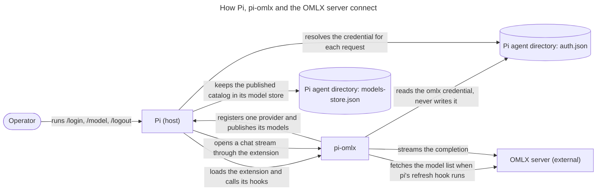

# ARCHITECTURE.md

pi-omlx is a Pi extension: it discovers the models an OMLX server offers and registers them as a native Pi provider, so `/model` and chat work the same way they do for a hosted provider. It runs inside the Pi process and owns no service of its own.

## 1. Project Structure

```
.            the extension's entry point: registers the one provider and wires its handlers
src/         every other module: the credential resolution, the catalog fetch and refresh hook, the native login, the provider object, the stream wrapper, the startup notice, debug tracing
test/        the suite, one file per module; test/isolation/ holds the harness that isolates a run
docs/        user documentation; docs/adr/ holds decisions, docs/architecture/ holds diagrams
openspec/    change records: living specs under specs/, in-flight changes under changes/, finished ones under changes/archive/
```

## 2. High-Level System Diagram



The same diagram is stored on its own in `docs/architecture/omlx-connections.mermaid`.

## 3. Core Components

- **Entry point.** Registers the one provider with Pi when the extension loads and wires the handlers: the startup warning, the thinking controls before each request, and the model-select trace. It holds no catalog of its own; the provider serves the list Pi chose from.
- **Credential resolution.** One rule that turns the credential Pi supplies, and the environment when Pi supplies none, into the base URL, the API key and which side the value came from. It runs inside the provider's `check` and `resolve` hooks, which is how Pi learns it for every request, and the login's probe runs the same function. A login with no key resolves to a placeholder the wire carries. See `docs/adr/0002-the-credential-resolution-runs-in-pi-hooks.md`, which supersedes the parts of `docs/adr/0001-one-credential-decides-the-omlx-connection.md` whose premises moved.
- **Catalog.** Fetches the model list over HTTP when Pi's refresh hook runs, keeps the models that report context and output limits, merges the optional metadata overlay, and publishes the result to Pi. It keeps no cache of its own.
- **Provider.** The one native provider Pi registers: the API-key login, the model list its refresh hook publishes, and both stream entry points.
- **Login.** `/login omlx` asks for the server URL and an optional key, fetches the catalog once with the credential it is about to return, and discards that result. A failure ends the login with an error naming its cause, and stores nothing; a success returns the credential, and Pi stores it. The extension never writes the credential.
- **Startup notice.** One function decides the single sentence a session's start earns, or none: the old-login remedy first, the landed-model warning second.
- **Stream wrapper.** Forwards chat completions to the OMLX server, applies the first-delta timeout, and normalizes failures into assistant errors.

## 4. Data Stores

- **Pi's credential store**, `auth.json` under Pi's agent directory. The extension reads the `omlx` entry and never writes it; storing a login is Pi's job. See `docs/adr/0002-the-credential-resolution-runs-in-pi-hooks.md`.
- **Pi's model store**, `models-store.json` under Pi's agent directory, keyed `omlx`. It holds the last catalog a refresh published. Pi restores it before a session exists, so a start has its models without a network request, and rewrites it on the next successful refresh; a refresh that fails leaves it alone. The extension writes no cache of its own, and the old `cache/omlx-models.json` stays on disk, unread.
- **The model metadata overlay**, at `~/.omlx/model_settings.json` or the path in `OMLX_MODEL_SETTINGS_PATH`. Per-model overrides applied before publication: the display name, the context window and max-out limits, the thinking default, the reasoning parser and the model type. Read-only, and optional.

## 5. External Integrations

- **Pi**, the host: extension API, provider registration, event context, and the credential store above.
- **Pi's credential hooks**, which decide what a request is authenticated with: Pi calls this provider's `check` and `resolve` and uses their answer, so the extension keeps no copy of Pi's order. See `docs/adr/0002-the-credential-resolution-runs-in-pi-hooks.md`.
- **The OMLX server**, over HTTP: the model list, and chat completions streamed back.

## 6. Deployment & Infrastructure

Installed into Pi from git with `pi install git:github.com/joelleibow/pi-omlx`. That is the only install path: the npm package name is a placeholder that registers nothing. There is no service, no network listener, no scheduled job and no build output. The process is the operator's Pi session, and its only writes are trace lines on stderr under `PI_OMLX_DEBUG`.

## 7. Security

- The extension sends the resolved credential to one place only: the server the same resolution names. Catalog and requests share it, so a key cannot be paired with a server chosen by a different source.
- Credentials are read from Pi's store and never written by the extension. `pi uninstall` does not touch them; `/logout` is the supported way to remove them.
- Debug tracing is off unless `PI_OMLX_DEBUG` is set, and a trace line records which side the resolution took rather than the key itself.
- Pi reads a stored key that begins with `$` or `!` as a template or a command, so a literal key starting with either can reach the server as something other than what was typed. The login cannot prevent it, and neither can the extension, because the read is Pi's.

## 8. Development & Testing

The suite is vitest, gated by Biome and a type check. Setup, triage and the live probes are described in [CONTRIBUTING.md](./CONTRIBUTING.md); the commands an agent runs are in [AGENTS.md](./AGENTS.md). `PI_OMLX_DEBUG` turns on the extension's trace lines.

The suite isolates itself on every run. A global setup in `test/isolation/` creates a per-run root under the system temporary directory, points `HOME` and `PI_CODING_AGENT_DIR` into it, clears the extension's own environment keys, and removes the root when the run ends. The worker setup in the same directory injects that root and fails the run when the agent directory, the home directory or the overlay path resolves outside the root. Every temporary path a test's fixture names lies under that root, created there when the test needs a directory, so the teardown covers it. A bare run therefore leaves the operator's agent directory and overlay alone.

## 9. Future Considerations

- Pi's model store is keyed by provider id, not by base URL. Changing `OMLX_BASE_URL` while a stored catalog exists restores the previous server's models until the next refresh replaces them.
- A stored key that begins with `$` or `!` is read as a template or a command, as above. Closing it means taking over Pi's read of the credential, which the provider contract does not offer.

## 10. Project Identification

- Name: pi-omlx
- Repository: github.com/joelleibow/pi-omlx
- Owner: Joel Leibow

## 11. Glossary

- **OMLX**: the local model server this extension talks to.
- **Saved login / stored credential**: the `omlx` entry in Pi's credential store, written by `/login` and removed by `/logout`.
- **Keyless**: a server that needs no API key. Reached by logging in with an empty key; an environment variable alone does not do it. Requests then carry a placeholder bearer.
- **Catalog**: the model list fetched from the server and published to Pi.
- **Model store**: Pi's file holding the last catalog this extension published, under Pi's agent directory and keyed `omlx`. The extension's older catalog cache is no longer read.
- **Source**: which side of the credential rule answered, the saved login or the environment. It appears on the trace line and never carries the key.
