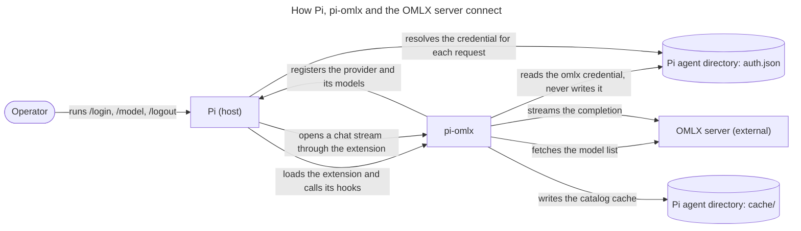

# ARCHITECTURE.md

pi-omlx is a Pi extension: it discovers the models an OMLX server offers and registers them as a native Pi provider, so `/model` and chat work the same way they do for a hosted provider. It runs inside the Pi process and owns no service of its own.

## 1. Project Structure

```
.            the extension's entry point: registers the provider, runs the catalog poll, wires the stream wrapper
src/         every other module: credential resolution, catalog fetch and cache, provider registration, the stream wrapper, login prompts, debug tracing
test/        the suite, one file per module
docs/        user documentation; docs/adr/ holds decisions, docs/architecture/ holds diagrams
openspec/    change records: living specs under specs/, in-flight changes under changes/, finished ones under changes/archive/
```

## 2. High-Level System Diagram



The same diagram is stored on its own in `docs/architecture/omlx-connections.mermaid`.

## 3. Core Components

- **Entry point.** Registers the provider with Pi at startup, starts the catalog poll, and wires the stream wrapper. It holds the extension's runtime state and decides when to fetch, when to register and when to fall back to a login-only provider.
- **Credential resolution.** One rule that turns the stored credential and the environment into the base URL, the API key and which side the value came from, for the catalog fetch and the registration together. Keyless is not in its answer: the registration derives it from an empty key and then registers no key at all. See `docs/adr/0001-one-credential-decides-the-omlx-connection.md`.
- **Catalog.** Fetches the model list over HTTP, caches it under Pi's agent directory, and merges the optional metadata overlay before anything is registered.
- **Provider registration.** Turns the resolved base URL, the environment-variable name the key is read from, and a model list into the provider definition Pi consumes.
- **Login prompts.** The `/login` flow: asks for the server URL and the key, triggers the fetch and registration before Pi stores the credential, and returns the credential Pi keeps. The entry point attaches these prompts to the provider it registers.
- **Stream wrapper.** Forwards chat completions to the OMLX server, applies the first-delta timeout, and normalizes failures into assistant errors.

## 4. Data Stores

- **Pi's credential store**, `auth.json` under Pi's agent directory. The extension reads the `omlx` entry and never writes it; storing a login is Pi's job. See `docs/adr/0001-one-credential-decides-the-omlx-connection.md`.
- **The catalog cache**, under the agent directory's `cache/`. Holds the last fetched model list with the server URL it came from and a timestamp, keyed by that URL, so a server change costs one refetch. Models are registered from it before the live fetch, so a saved catalog is available immediately. Startup still waits on that fetch, each of its requests bounded at two seconds, and the poll loop takes over afterwards.
- **The model metadata overlay**, at `~/.omlx/model_settings.json` or the path in `OMLX_MODEL_SETTINGS_PATH`. Display names, token limits and thinking budgets, which the OMLX API does not return. Read-only, and optional.

## 5. External Integrations

- **Pi**, the host: extension API, provider registration, event context, and the credential store above.
- **pi-ai's credential resolution**, which decides what a chat request is authenticated with. The extension cannot read its answer, so it restates that order in one place and pins the copy with tests.
- **The OMLX server**, over HTTP: the model list, and chat completions streamed back.

## 6. Deployment & Infrastructure

Installed into Pi from git with `pi install git:github.com/joelleibow/pi-omlx`. That is the only install path: the npm package name is a placeholder that registers nothing. There is no service, no network listener, no scheduled job and no build output. The process is the operator's Pi session, and its only writes are the catalog cache and, under `PI_OMLX_DEBUG`, trace lines on stderr.

## 7. Security

- The extension sends the resolved credential to one place only: the server the same resolution names. Catalog and requests share it, so a key cannot be paired with a server chosen by a different source.
- Credentials are read from Pi's store and never written by the extension. `pi uninstall` does not touch them; `/logout` is the supported way to remove them.
- Debug tracing is off unless `PI_OMLX_DEBUG` is set, and a trace line records which side the resolution took rather than the key itself.
- A stored `api_key` whose key is a template or a command is interpolated by Pi for requests and used verbatim for the catalog fetch. Both reach the same server; the difference predates the credential rule and is recorded in the ADR.

## 8. Development & Testing

The suite is vitest, gated by Biome and a type check. Setup, triage and the live probes are described in [CONTRIBUTING.md](./CONTRIBUTING.md); the commands an agent runs, and the agent directory every run must point at, are in [AGENTS.md](./AGENTS.md). `PI_OMLX_DEBUG` turns on the extension's trace lines.

## 9. Future Considerations

- The test seams that let a test point the credential store at a file are due for removal; the agent directory variable is the replacement, and new tests already take that route.
- One catalog helper has no callers and is kept deliberately for a later change.
- The resolution mirrors pi-ai's order. A Pi upgrade is the moment to re-read that order against the copy and its tests.
- Removing the startup wait on the live model fetch is a planned change.
- A stored `api_key` holding a template or a command behaves differently in the catalog than in requests, as above. Closing it means deciding whether the catalog interpolates at all.

## 10. Project Identification

- Name: pi-omlx
- Repository: github.com/joelleibow/pi-omlx
- Owner: Joel Leibow

## 11. Glossary

- **OMLX**: the local model server this extension talks to.
- **Saved login / stored credential**: the `omlx` entry in Pi's credential store, written by `/login` and removed by `/logout`.
- **Keyless**: a server that needs no API key. Reached by logging in with an empty key; an environment variable alone does not do it.
- **Catalog**: the model list fetched from the server and registered with Pi.
- **Catalog cache**: the file holding the last fetched list, keyed by the server URL it came from.
- **Source**: which side of the credential rule answered, the saved login or the environment. It appears on the trace line and never carries the key.
